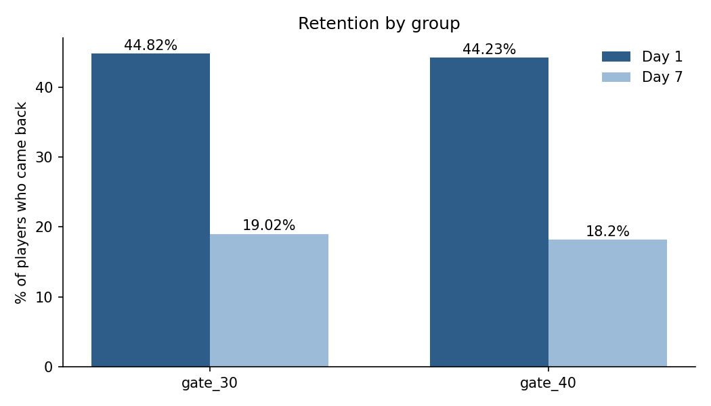

# Cookie Cats A/B test: did moving the first gate hurt retention?

An analysis of a real A/B test from **Cookie Cats**, a mobile puzzle game. The developers moved the game's first forced break (a "gate") from level 30 to level 40, and randomly split 90,189 new players between the two versions. This project checks whether the change affected how many players came back after 1 and 7 days.

## Result

| | gate_30 (control) | gate_40 (test) | Real difference? |
|---|---|---|---|
| Day 1 retention | 44.8% | 44.2% | No (p ≈ 0.08) |
| Day 7 retention | 19.0% | 18.2% | **Yes** (p ≈ 0.002) |

**Recommendation: keep the gate at level 30.** Moving it doesn't change whether players return the next day, but fewer are still playing after a week. One possible explanation is that an earlier break keeps players from burning out on the game.



## What the analysis does

1. **Checks the data:** one row per player, no missing values, and the two groups are about equal in size, as a random split should be.
2. **Explores player behaviour:** half of all players played 16 rounds or fewer in their first two weeks, and one extreme outlier (49,854 rounds) is likely a bot or tracking error.
3. **Calculates retention per group** in both SQL (DuckDB) and pandas.
4. **Tests whether the differences are real** with a chi-square test.

The full analysis, with explanations, is in [`analysis.ipynb`](analysis.ipynb).

## Limitations

- The data has no revenue, so the test can't show whether gate_40 earns more money despite lower retention.
- Only the first 14 days of each player are covered.

## Run it

```bash
pip install -r requirements.txt
jupyter notebook analysis.ipynb
```

## Tools

Python (pandas, matplotlib, SciPy) · SQL (DuckDB) · Jupyter

## Data

Public dataset of the Cookie Cats A/B test, originally published as a DataCamp project and widely available on GitHub. Built with AI assistance (Claude).
